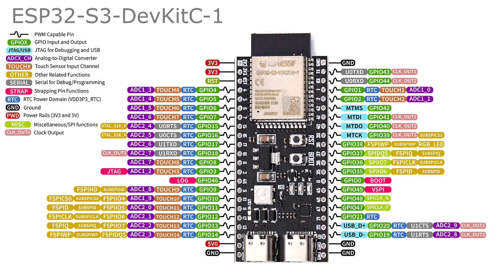

# Controller board — YD-ESP32-S3 (N8R2)

Reference sheet for the board the controller firmware runs on
(`firmware/controller/`).

The board is VCC-GND Studio's **YD-ESP32-S3**, printed on the back as
"YD-ESP32-23" and "2022-V1.3". It copies Espressif's ESP32-S3-DevKitC-1: the
pin header is the same pin for pin, and the RGB LED is on GPIO 48, as on the
DevKitC-1 v1.0.

The rules come from `docs/`, which wins over this sheet if the two ever disagree:
`System_Plan.md` §2 (the hardware and pin map) and §8.2 (the controller). In
code, the board's pins are named in `controller/include/pinlayout.hpp` and the
bin's signals are assigned to them in `controller/include/pins.hpp`. The "Used
for" column below copies those for reading; if it and the code disagree, the
code is right and this sheet is out of date.

**This image is wrong about one pin on our board:** it shows the RGB LED on
GPIO 38, as on Espressif's DevKitC-1 v1.1. On the YD-ESP32-S3 the RGB LED is on
GPIO 48 and GPIO 38 is a plain GPIO. Everything else in it matches.

## The board

| Item | Value |
|---|---|
| Board | VCC-GND Studio YD-ESP32-S3, board revision 2022-V1.3: a copy of the ESP32-S3-DevKitC-1 |
| Module | ESP32-S3-WROOM-1-N8R2 |
| Chip | ESP32-S3: dual-core Xtensa LX7, up to 240 MHz |
| Internal memory | 512 KB SRAM, 384 KB ROM, 16 KB RTC SRAM |
| Flash | 8 MB, quad SPI ("N8") |
| PSRAM | 2 MB, quad SPI ("R2") |
| Operating temperature | −40 to 85 °C (the N8R2 module) |
| Wireless | Wi-Fi 802.11 b/g/n (2.4 GHz only), Bluetooth 5 (LE) |
| Logic level | 3.3 V. **The pins don't tolerate 5 V.** |
| ADC | Two 12-bit SAR ADCs, 20 channels (ADC1: 10, ADC2: 10) |
| Touch | 14 capacitive touch channels |
| PWM | LEDC, 8 channels; also 2 MCPWM units |
| Other peripherals | 3 UART, 2 I2C, 2 I2S, 4 SPI (2 for flash and PSRAM, 2 general-purpose), TWAI (CAN), USB OTG, USB Serial/JTAG |
| USB ports | Two USB-C: the USB-to-UART port, through a CH343P bridge to UART0, and the ESP32-S3 USB port, wired to the chip's USB (GPIO 19 and 20) |
| Buttons | BOOT (GPIO 0) and RST |
| On-board LEDs | A WS2812 addressable RGB LED on GPIO 48; a power LED; TX and RX LEDs on the serial log lines (GPIO 43 and 44) |
| Power | Three ways, never more than one at a time: the USB ports (either or both), the 5V and G pins, or the 3V3 and G pins. A 5 V to 3.3 V LDO (1 A) on the board feeds the module |

### How the PlatformIO setup matches this board

`controller/platformio.ini` uses `board = esp32-s3-devkitc-1`. That board file
describes the N8 (no PSRAM), so two lines add the PSRAM:
`board_build.arduino.memory_type = qio_qspi` (quad flash, quad PSRAM) and
`-DBOARD_HAS_PSRAM`. The platform is pinned to `espressif32@7.1.3` (Arduino
core 2.0.17).

The serial log (`Serial`) goes to UART0, GPIO 43 and 44, so it comes out of the
**USB-to-UART** port. Plug into that port to flash and to run
`pio device monitor`.

## Pin header

Pin 1 is at the antenna end. Functions are from the YD-ESP32-S3 README, whose
tables match Espressif's for the DevKitC-1. The YD board calls the headers P1
and P2; Espressif calls them J1 and J3. Every GPIO can do PWM.

### Left header (P1, J1 on Espressif's board)

| Pin | Name | Functions | Used for |
|---|---|---|---|
| 1 | 3V3 | 3.3 V out | |
| 2 | 3V3 | 3.3 V out | |
| 3 | RST | Reset (EN) | |
| 4 | GPIO4 | ADC1_3, TOUCH4 | Load cell data (HX711) |
| 5 | GPIO5 | ADC1_4, TOUCH5 | Load cell clock (HX711) |
| 6 | GPIO6 | ADC1_5, TOUCH6 | Ultrasonic trigger |
| 7 | GPIO7 | ADC1_6, TOUCH7 | Ultrasonic echo (through a divider) |
| 8 | GPIO15 | ADC2_4, U0RTS, XTAL_32K_P | LED strip (PWM) |
| 9 | GPIO16 | ADC2_5, U0CTS, XTAL_32K_N | Actuator driver enable |
| 10 | GPIO17 | ADC2_6, U1TXD | Actuator extend (RPWM) |
| 11 | GPIO18 | ADC2_7, U1RXD, CLK_OUT3 | Actuator retract (LPWM) |
| 12 | GPIO8 | ADC1_7, TOUCH8 | Green LED |
| 13 | GPIO3 | ADC1_2, TOUCH3, **strapping (JTAG)** | Reserved |
| 14 | GPIO46 | **Strapping (LOG)** | Reserved |
| 15 | GPIO9 | ADC1_8, TOUCH9, FSPIHD | Amber LED |
| 16 | GPIO10 | ADC1_9, TOUCH10, FSPICS0 | Red LED |
| 17 | GPIO11 | ADC2_0, TOUCH11, FSPID | Free |
| 18 | GPIO12 | ADC2_1, TOUCH12, FSPICLK | Free |
| 19 | GPIO13 | ADC2_2, TOUCH13, FSPIQ | Free |
| 20 | GPIO14 | ADC2_3, TOUCH14, FSPIWP | Buzzer |
| 21 | 5V0 | 5 V in or out | |
| 22 | GND | Ground | |

### Right header (P2, J3 on Espressif's board)

| Pin | Name | Functions | Used for |
|---|---|---|---|
| 1 | GND | Ground | |
| 2 | GPIO43 | U0TXD | Reserved: serial log |
| 3 | GPIO44 | U0RXD | Reserved: serial log |
| 4 | GPIO1 | ADC1_0, TOUCH1 | Actuator current sense |
| 5 | GPIO2 | ADC1_1, TOUCH2 | Free |
| 6 | GPIO42 | MTMS (JTAG) | Free |
| 7 | GPIO41 | MTDI (JTAG) | Free |
| 8 | GPIO40 | MTDO (JTAG) | Free |
| 9 | GPIO39 | MTCK (JTAG) | Free |
| 10 | GPIO38 | FSPIWP | Free |
| 11 | GPIO37 | SPIDQS, FSPIQ | Free |
| 12 | GPIO36 | SPIIO7, FSPICLK | Free |
| 13 | GPIO35 | SPIIO6, FSPID | Free |
| 14 | GPIO0 | **Strapping (BOOT)** | Reserved |
| 15 | GPIO45 | **Strapping (VSPI)** | Reserved |
| 16 | GPIO48 | SPICLK_N, **RGB LED** | Reserved: RGB LED |
| 17 | GPIO47 | SPICLK_P | Free |
| 18 | GPIO21 | | Free |
| 19 | GPIO20 | USB D+, ADC2_9 | Reserved: USB |
| 20 | GPIO19 | USB D−, ADC2_8 | Reserved: USB |
| 21 | GND | Ground | |
| 22 | GND | Ground | |

GPIO 26 to 32 are wired to the module's flash and PSRAM and aren't on the
header.

## Things to know when wiring

- **Strapping pins (0, 3, 45, 46).** The chip reads them at reset to pick its
  boot mode. Something on them that pulls the wrong way at power-up can stop
  the board from booting, or (GPIO 45) set the wrong flash voltage. Keep them
  free.
- **ADC2 is unusable while Wi-Fi is on.** The controller is always on Wi-Fi, so
  any analog input must be an ADC1 pin (GPIO 1 to 10). That is why the
  current sense is on GPIO 1.
- **ADC range.** At the Arduino core's default attenuation (11 dB, ATTEN3)
  the ADC's effective range is 0 to 2.9 V, within ±50 mV after calibration;
  anything above reads as the maximum. The current-sense load
  resistor has to keep the BTS7960's IS output under that at a stall.
- **GPIO 35, 36 and 37 are free on this board.** The image labels them for
  PSRAM, but only octal-PSRAM modules (R8) use them. The N8R2's PSRAM is quad.
- **GPIO 39 to 42 are the JTAG pins.** They're free unless someone debugs with
  an external JTAG probe; the built-in USB JTAG uses GPIO 19 and 20 instead.
- **The RGB LED is on GPIO 48** on this board. On Espressif's own
  DevKitC-1 it moved from GPIO 48 (v1.0) to GPIO 38 (v1.1), so a pinout found
  online may show either; for the YD-ESP32-S3, trust GPIO 48. It is a WS2812:
  drive it with `neopixelWrite()`, not `digitalWrite()`.
- **TX and RX LEDs.** GPIO 43 and 44 carry the serial log and each has an LED
  on it, which flickers whenever the log is written.
- **3.3 V only.** A 5 V signal (the HC-SR04's echo, for one) goes through a
  divider or a level shifter.
- **Current per pin.** The default drive is 20 mA, except GPIO 17 and 18
  (10 mA) and GPIO 19 and 20 (40 mA): enough for an indicator LED with its
  resistor. Anything bigger (buzzer, LED strip, driver)
  goes through a transistor or the driver board, as it already does.

## Sources

Checked on 2026-11-27 against:

- Espressif, ESP32-S3-DevKitC-1 v1.1 user guide: header tables J1 and J3,
  USB ports, power options, the RGB LED pin by revision, the GPIO 35 to 37
  note. Source text:
  <https://github.com/espressif/esp-dev-kits/blob/master/docs/en/esp32-s3-devkitc-1/user_guide_v1.1.rst>
- Espressif, ESP32-S3 Series Datasheet v2.2: specifications, analog functions
  (Table 2-8), GPIO restrictions (§2.3.4, §2.3.5), strapping pins (§3), drive
  strength, ADC range (Table 5-6):
  <https://www.espressif.com/sites/default/files/documentation/esp32-s3_datasheet_en.pdf>
- Espressif, ESP32-S3-WROOM-1 & WROOM-1U datasheet: the N8R2's flash and PSRAM
  type and its temperature range:
  <https://www.espressif.com/sites/default/files/documentation/esp32-s3-wroom-1_wroom-1u_datasheet_en.pdf>
- VCC-GND Studio, YD-ESP32-S3 README: header tables P1 and P2, the RGB LED on
  GPIO 48, the TX and RX LEDs, the CH343P bridge, the LDO:
  <https://github.com/vcc-gnd/YD-ESP32-S3>
- The pinout image above, supplied by the firmware lead. It matches the
  header tables except for the RGB LED pin.
